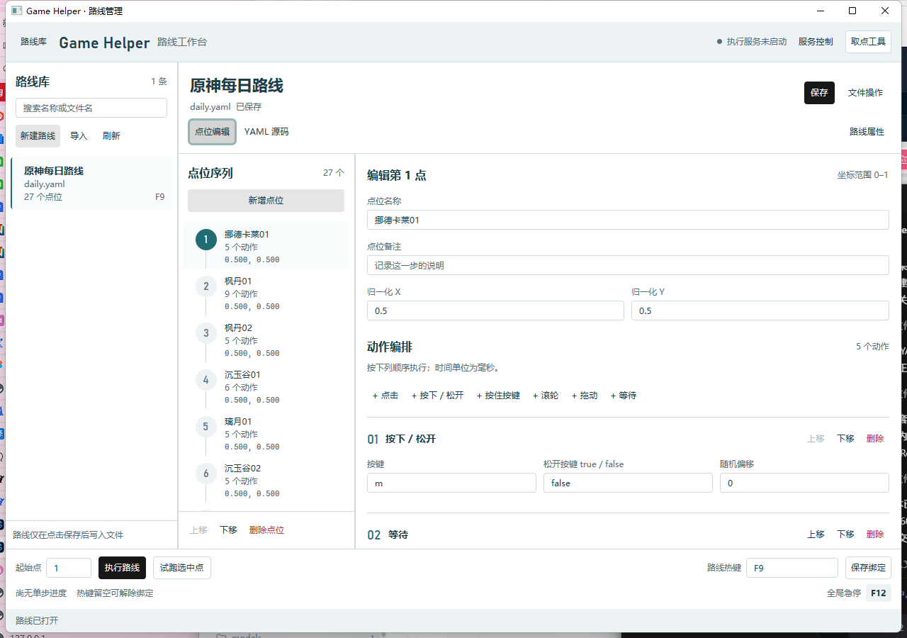

# 路线管理器界面重设计

Rust + GPUI Kit 0.9.0 原生管理器的浅粉路线编排工作台。通过 `start.bat` 统一启动 Rust 客户端；Python 客户端与回退入口已删除。项目内置 AHK v2.0.31，daemon 服务统一负责回放。

## 路线快捷键开关与服务执行

路线列表中，每项右侧显示独立 Switch，启用状态写入 `config.json` 的 `hotkeys.bindings[].enabled`，重启后恢复。切换开关不会触发路线选择或提交当前草稿；未绑定时保持关闭并提示先设置快捷键。不同路线可以使用同一快捷键，最后开启的路线生效，其他同键路线自动关闭并保留原绑定；关闭胜出路线不会恢复之前被关闭的路线。旧配置未包含 `enabled` 的绑定默认开启。

执行栏不提供手动快捷键输入框。点击“设置快捷键”打开监听弹窗，按下一个按键或组合键后自动保存并关闭弹窗；新绑定默认关闭，修改已有绑定保留原开关状态，已开启时应用同键互斥。取消保留原设置，清除按钮移除绑定。当前快捷键单独展示，“保存起始点”只保存单步起始位置。监听时仅按修饰键不会完成录制。

所有按钮试跑与全局热键回放都通过 AHK 服务完成。服务未运行时禁用试跑并提示启动服务；配置写入、服务忙碌或状态未知时避免竞争操作。开关关闭只影响路线快捷键，服务就绪时仍可按钮试跑。服务控制提供启动、停止与重载，关闭管理器后服务继续运行。

自动化稳定 ID：设置/清除/当前快捷键分别为 `hotkey-set`、`hotkey-clear`、`hotkey-current`，监听弹窗与取消按钮为 `hotkey-dialog`、`hotkey-capture-cancel`；路线 Switch 的容器为 `route-hotkey-{stem}`，开关自身通过可访问 TogglePattern 操作。`bind` 保留用于“保存起始点”。

[快捷键 UI 回归](../scripts/smoke-manager-hotkeys.ps1) 使用唯一隔离目录和关闭服务自启的配置，检查捕获/取消/清除、同键开关互斥、起始点独立保存及重启恢复。录制消息仅投递到测试窗口，不发送全局键盘输入。脚本不请求回放；离线断言要求无正在运行的生产服务，检测到服务会停止检查。本轮 Release 的隔离回归已 exit 0，覆盖捕获/取消/清除、旧绑定默认开启、同键最后开启者胜出、不自动恢复、开关不选择路线、起始点独立保存及重启恢复；证据见[本轮快捷键回归摘要](../.tools/manager-hotkeys-5e8fa5bef82646c4987b8d9bf57a4d67/summary.json)。此回归没有请求回放：

```powershell

pwsh -NoProfile -File scripts\smoke-manager-hotkeys.ps1 -Executable target\release\game-helper.exe

```

## 动作编排与展开状态持久化（2026-11-09）

本次围绕重复动作编排调整布局：顶部七个添加按钮收进“添加动作”菜单，为列表保留高度；每条动作右侧提供“在下方添加”。顶部菜单追加到末尾，行内菜单插入当前动作之后，新增动作展开、定位并聚焦名称，其他动作的内容及展开状态保持。

动作上移/下移按钮改为独立拖拽手柄，输入框和文本选择不启动排序。拖动时显示摘要及插入线，按展开/收起后的实际行高判断落点，靠近上下边缘自动滚动；Escape 或列表外释放取消。手柄可聚焦，Alt+↑/↓ 调整顺序，点击手柄打开目标序号输入，提供无需拖拽的鼠标操作。

点位底部的“复制”按钮将选中点位复制到原点位后，生成新 ID 和“（副本）”名称，自动选中新副本。名称、备注、动作参数和展开状态均复制，之后互相独立；复制仍需通过路线保存落盘。文件操作的导出、定位文件及删除路线统一为 32 DIP 高度的描边按钮，删除保持危险色，沿用原有删除确认。

`state/manager-ui.json` 使用 `manager-ui/v1` 版本，与路线格式及回放分离。路线键为应用根目录下的规范化相对路径，点位以 ID 及同 ID 出现次序区分；每条动作有独立界面身份、展开值和规范化内容描述。表单排序及参数修改保留身份；源码或外部编辑后的重建按内容和重复项出现次序匹配，无法匹配的动作默认展开。完全相同动作的源码交换按出现次序解释。整个便携目录移动后相对路径仍有效。

展开/收起约 300ms 防抖自动保存，后台串行写入并使用修订号避免旧状态覆盖新状态，正常关闭等待最新写入完成。无需点击路线保存；只查看不创建状态文件。保存失败时显示可重试提示，损坏、未知版本和冲突均保留原文件，正常路线编辑及保存不受影响；关闭前失败可选择直接关闭，本次未写入状态可能丢失。

实现分工：[界面](../crates/game-helper-desktop/src/manager/view.rs)、[原生拖拽与移动](../crates/game-helper-desktop/src/manager/interaction.rs)、[编辑器持久化及序列修改](../crates/game-helper-desktop/src/manager/persistence.rs)、[状态存储及身份匹配](../crates/game-helper-core/src/manager_ui.rs)。

本次最终 Release 已通过工作区 **106 项测试**，另有 1 个仅由父测试启动的私有入口保持 ignored；格式检查、Clippy 和 Release 构建通过，Clippy 保留部分文档及风格警告。三套隔离原生回归全部通过：[动作编排](../scripts/smoke-manager-actions.ps1)、[控件兼容](../scripts/smoke-manager-controls.ps1)、[布局边界](../scripts/smoke-manager-density.ps1)。动作回归包含真实鼠标排序、混合行高、边缘自动滚动、Escape/列表外释放取消、开头和中间插入、独立复制、跨点位/路线/重启恢复，以及外部损坏状态文件的保留、失败提示、重试和直接关闭。仅改变展开状态时，路线与配置的内容和修改时间不变，也不生成执行缓存。

96 DPI、路线属性及服务详情收起时的最终实测：

| 客户区及路线库状态 | 动作工具栏高度 | 动作列表高度 | 相对上一版增加 |

|---|---:|---:|---:|

| 1280×900，路线库展开 | 35 DIP | 712 DIP | 31 DIP |

| 900×640，路线库收起 | 35 DIP | 452 DIP | 31 DIP |

| 900×640，路线库展开 | 35 DIP | 452 DIP | 62 DIP |

文件操作展开后，三个按钮均为 32 DIP 且同一基线；小窗口动作列表仍有 399 DIP。默认及紧凑窗口保留路线/点位 48/36 DIP 行高与 2 DIP 间隔。实际截图已目视复核：[默认三栏](assets/native-manager-sequence-default.png)、[小窗口](assets/native-manager-sequence-compact.png)、[文件操作](assets/native-manager-sequence-files.png)。本轮未覆盖多 DPI、多显示器或真实游戏回放。

最终原生验收记录保存在 `.tools/manager-actions-09999577767147a98df5f5d0c081e0f0/`、`.tools/manager-controls-5487b0bfc72a4a7bb8b92e0510385421/` 和 `.tools/manager-density-9b82f699cac247cd94484f726d787d80/`。回归全部使用各自隔离目录，未修改用户路线、配置或热键绑定。重新打开客户端即可使用本次 Release。

## #FBA1DB 主题与紧凑布局（2026-11-08）

路线管理与取点工具共用浅粉主题。核心色严格使用 `#FBA1DB`，配极浅粉白底、白色编辑面和灰紫文字；主按钮采用深梅色文字而非白字。主题覆盖输入框、下拉菜单、悬停、按下、禁用、键盘焦点、选中、滚动条、确认层和错误反馈。

主题通过 `Theme::update` 同步颜色字段、组件背景 token 与 Base 投影，避免主按钮出现旧深色背景配新深色文字。管理器路线和点位采用专用选中背景 `#F8C4E4`、深梅色左边线及正式按钮选中态；悬停和焦点移入输入框后仍保持不透明背景。通用轻量选中背景继续使用 `#FDE5F4`。

路线名称、文件名、保存状态、编辑模式与路线操作合并到顶部紧凑命令栏。保存状态紧跟文件名，保留 8 DIP 间隔；长名称和文件名省略并提供全文提示，保存状态保持完整。窄窗口按组换行，保存按钮保持可用。路线属性仍按需展开，缺少目标条件时自动展开；展开区最多 160px，超出后在区内滚动。文件操作继续按需展开。

底部执行区域提供起始点、“保存起始点”、选中点试跑、当前快捷键、“设置快捷键”、清除按钮和真实急停键。快捷键使用监听弹窗捕获，新绑定默认关闭，修改已有绑定保留开关状态，不使用手动输入框。起始点输入框通过 `Styled::h` 将完整外框固定为 32 DIP，与相邻按钮等高；保留小号文字。单步进度显示在最底部状态栏。状态消息保持单行、全文可悬停查看，错误时优先显示错误反馈，进度仍包含在可访问名称中。起始点与动作参数沿用已有输入实体；路线格式及 AHK IPC 不变，快捷键启用状态保存在配置中。

以下为同一套 36 个动作隔离数据、相同面板宽度、属性及服务详情收起、96 DPI 下的 UI Automation 实测。窗口尺寸指客户区，像素值在此等于 DIP：

| 客户区及路线库状态 | 调整前动作列表 | 调整后动作列表 | 增加高度 | 调整后动作工具栏 |

|---|---:|---:|---:|---:|

| 1280×900，路线库展开 | 518px | 681px | **163px** | 66px |

| 900×640，路线库收起 | 258px | 421px | **163px** | 66px |

| 900×640，路线库展开 | 223px | 390px | **167px** | 97px，添加按钮换行 |

三种布局的服务栏均为 35px、路线命令栏 53px、执行栏 39px、状态栏 26px。动作列表在“动作工具栏＋列表”中的占比分别为 91.2%、86.4%、80.1%；这些比例不是整个窗口的占比。

实际 Release 原生截图：[调整前](assets/native-manager-pink-before.png)、[调整后默认窗口](assets/native-manager-pink.png)、[小窗口](assets/native-manager-pink-compact.png)、[小窗口展开路线库](assets/native-manager-pink-library-open.png)。当前模型不支持图片输入，因此可见区域结论来自控件边界和实际交互，未声称完成截图的逐像素目视审查。

[动作交互回归](../scripts/smoke-manager-actions.ps1)新增顶部、执行栏、状态栏高度和关键控件边界检查，并保存各尺寸的 JSON 测量记录。当前 Release 已通过该回归：七类动作、长列表新增定位、折叠、排序、名称及参数保留、保存、YAML 往返、路线切换和重启恢复。工作区 **88 项测试通过**，另有 1 个由父测试启动的私有子进程入口保持 ignored；编译检查和 Release 构建通过，保留既有文档警告。控件回归也已通过，包括中文下拉选项、坐标与起始点保留、范围提示和路线切换保护。

```powershell

scripts\cargo.cmd check --workspace --locked

scripts\cargo.cmd test --workspace --locked

scripts\cargo.cmd fmt --all -- --check

scripts\cargo.cmd build -p game-helper-desktop --release --locked

pwsh -NoProfile -File scripts\smoke-manager-actions.ps1 -Executable target\release\game-helper.exe -CaptureScreenshots

pwsh -NoProfile -File scripts\smoke-manager-controls.ps1 -Executable target\release\game-helper.exe

```

[紧凑边界回归](../scripts/smoke-manager-density.ps1)也已通过空路线库欢迎页、长路线名 / 点位名 / 文件名、默认及小窗口路线库切换、文件操作、表单 / YAML 往返、零点位、900 字符以上完整校验消息和缺少目标的草稿引导。小窗口展开属性时，属性面板实测 147px，目标标题可滚动查看；长错误状态栏仍为 26px。取点布局、坐标真实粘贴及点位排序回归通过，另修复窗口库切换导致行高变化后当前点位滚出视野的问题，见[取点工具说明](picker-design.md)。

本次四处视觉修复通过同一紧凑边界回归：96 DPI 下，两处执行输入框的完整外框及相邻按钮均为 32 DIP，文件名到保存状态的间距为 8 DIP。原生像素取样确认保存按钮普通 / 悬停背景分别为 `#FBA1DB` / `#F78BCF`；路线与点位选中背景为 `#F8C4E4`，悬停及输入框获得焦点后保持一致。选中项辅助文字使用 `#645164`，对比度约 4.83:1；保存按钮文字在普通 / 悬停 / 按下背景上的对比度约 7.38:1 / 6.28:1 / 5.35:1。控件回归与取点布局回归通过，长短文件名及小窗口均保持状态可见。

原生客户端需重新打开后使用更新的 Release 产物。UI 检查使用隔离目录并关闭自动执行服务，没有请求游戏回放。多 DPI、多显示器、系统 IME 和真实游戏回放未在本次改版中验收。

## 路线库与点位序列的紧凑列表

路线条目固定 **48 DIP**，条目间距 **2 DIP**。第一行是名称与点位数，第二行是文件名与绑定热键，右侧独立 Switch 控制快捷键启用；错误路线在第一行右侧显示“格式有误”，不额外增加一行。长名称、文件名及热键单行省略，整项悬停提示与可访问名称提供完整信息，错误详情仍可通过打开修复查看。路线库搜索框和新建 / 导入 / 刷新按钮均为 28 DIP，顶部与底部减少留白。

点位条目固定 **36 DIP**，间距 **2 DIP**，以“序号 / 名称 / 动作数”单行排列。序号改为右对齐数字列，至少容纳三位数；移除圆形序号和纵向连接线。名称保持 14 DIP，动作数保持 12 DIP，长名称省略后可悬停查看全文。标题、总数及新增点位合并为一行，上移 / 下移 / 删除继续固定在底部，操作按钮为 28 DIP。

两处列表保留粉色选中背景、深梅色左边线、原生按钮语义及独立滚动。仅调整呈现，不修改路线格式、配置或执行行为。`route-list` 与 `points` 提供稳定的可访问容器边界，供隔离 UI 检查测量行高及可见数量。

本次 Release 在 96 DPI 下使用 27 条路线、120 个点位的隔离数据测量，属性及服务详情收起，路线库展开：

| 客户区 | 路线完整可见数 / 视口高 | 点位完整可见数 / 视口高 | 条目高度 / 间隔 |

|---|---:|---:|---|

| 1280×900 | 13 条 / 656 DIP | 17 个 / 662 DIP | 路线 48、点位 36、间隔 2 DIP |

| 900×640 | 7 条 / 396 DIP | 10 个 / 402 DIP | 路线 48、点位 36、间隔 2 DIP |

两种尺寸各另有 1 条路线、1 个点位部分可见，未计入完整可见数。长名称、长热键和错误路线不增加行高；第 100 点可访问名称包含完整名称及动作数。切换第 100 / 首 / 末点、首尾排序禁用、排序往返、点位增删、表单 / YAML 往返、选中项悬停及输入框聚焦时的背景色检查均通过。额外隔离检查通过真实拖动，将路线 / 点位面板缩至 215 / 210 DIP（扣除右侧 1 DIP 边框后列表视口为 214 / 209 DIP），条目高度保持 48 / 36 DIP，工具按钮未超出窗口；按文件名 / 显示名搜索、无结果及清空恢复通过。

工作区编译检查、格式检查、88 项测试及 Release 构建通过，另有 1 个私有子进程测试入口 ignored；Clippy 通过并保留既有警告。控件回归通过；动作回归首次在点位信息展开处遇到一次等待超时，未修改实现，独立重跑后完整通过。列表与边界检查通过，记录保存在 `.tools/manager-density-f5afe95f786945409f0fcef0ebeab06f/`；最小面板宽度检查记录在 `.tools/manager-density-ca3a7a23e5d84353908ebc25f9d96a79/`。

实际原生截图：[默认窗口](assets/native-manager-compact-lists.png)、[小窗口](assets/native-manager-compact-lists-small.png)、[最小面板宽度](assets/native-manager-compact-lists-min-width.png)。本次依据 UI Automation 边界、原生像素取样和交互验证；当前图片通道不可用，未完成截图目视验收。多 DPI、多显示器及真实游戏回放未覆盖。重新打开客户端后使用本次 Release。

## 界面结构

- **路线库**：名称和文件名搜索，48 DIP 双行路线摘要、点数与绑定热键，明确的当前选择；每行独立 Switch 控制快捷键启用，切换不会打开路线或改变当前编辑对象。新建区按需展开；新建仍是内存草稿，显式保存后才写入文件。坏文件可打开修复。

- **路线工作区**：原生窗口标题为“路线管理”，顶部不再显示品牌或“路线工作台”标题，仅保留路线库、服务状态与工具控件。工作区提供路线标题与保存状态、保存按钮、点位编辑 / YAML 切换。路线属性与文件操作分别展开，导出、定位文件和删除保持原有动作。

- **点位序列**：36 DIP 单行显示独立拖动手柄、真实执行序号、名称及动作数；列表和动作编辑区独立滚动。拖动手柄可调整执行顺序，插入线标记目标位置，靠近上下边缘自动滚动；Escape 或列表外松开取消。点击手柄选中点位后可用 Alt+↑/↓ 排序，底部上移 / 下移按钮继续可用，首尾按钮禁用。排序保持当前选中点位、未保存的名称与动作参数，以及动作展开状态；保存后新顺序生效。零点位与零动作有引导。编辑区的点位名称、备注默认收起，点击工具栏“点位信息”才显示在滚动内容首部，展开后也可滚出视野，不占固定区域。新生成 YAML / 缓存不保存点位层 `pos`，旧字段兼容读取并忽略，点击与拖动动作自身的坐标仍可编辑。

- **动作编辑**：固定工具栏显示当前点位名、动作数量、点位信息、全部展开/收起和“添加动作”菜单。动作列表独立滚动，顶部菜单追加末尾，每条动作的“在下方添加”菜单插入当前动作之后，新增后定位到名称输入。每条动作提供独立拖拽手柄、执行序号、名称、类型、单项展开/收起和删除控件；收起时保留名称和类型。拖动手柄调整顺序，点击手柄可输入目标序号，手柄聚焦后 Alt+↑/↓ 也可调整。展开状态保存在独立的 manager-ui 状态文件，随排序、插入、删除、切换点位、路线及重启恢复，不触发路线校验或脏状态。参数标注单位与输入格式，点击的鼠标按键使用“左键 / 右键 / 中键”下拉框，按下 / 松开的按键动作使用“按下 / 松开”下拉框。名称与参数均提供包括动作序号的中文可访问名称和稳定 ID。

- **固定执行栏与状态栏**：执行栏提供起始点及“保存起始点”、选中点试跑、当前快捷键、设置/清除快捷键及真实急停键；单步进度显示在最底部状态栏。管理器不提供整条路线连续执行入口。切换路线时起始点读取该路线绑定值，无绑定时显示 1。所有回放统一通过执行服务，服务未启动时试跑禁用；路线快捷键关闭仍允许服务就绪时的按钮试跑。受理请求不表示试跑完成。

- **确认区域**：保存 / 放弃 / 取消等原有分支使用覆盖式确认区域；焦点进入取消按钮，Escape 可取消。确认层在编辑器与调整面板之上处理点击。

布局设计基准为 1280×900；小于 1100px 时路线库默认折叠，可通过顶栏重新展开。用户手动选择的展开状态在本次会话中保留。最小客户区为 900×640，原生标题栏与边框另计；本机紧凑截图为 916×679。

## 紧凑动作编排布局

点位基础信息默认不渲染表单；点击固定工具栏的“点位信息”才在滚动区首部展开，名称和备注可以随内容滚出视野。工具栏显示点位摘要、动作数量、信息开关、全部展开/收起和包含七类动作的添加菜单。动作参数收起时仍保留序号、名称和类型。

本次在 96 DPI 下通过 UI Automation 测量工具栏和列表边界：1280×900 时列表占右侧点位编辑区高度的 86.3%，900×640 时占 75.9%；紧凑窗口手动展开路线库后仍占 65.6%。比例为列表高度除以“工具栏＋列表”高度，不是整个客户区的比例。首次打开、重新打开以及调整窗口后的首动作应保持在视窗内。

实际原生窗口截图：[默认布局](assets/native-manager-actions.png)、[紧凑布局](assets/native-manager-actions-compact.png)、[紧凑窗口展开路线库](assets/native-manager-actions-library-open.png)。这些截图对应已验证的布局；交互回归结果另列。当前模型不支持图像输入，视觉验证以控件边界及真实交互为依据，未声称完成截图逐像素审查。

[动作交互回归脚本](../scripts/smoke-manager-actions.ps1) 使用唯一隔离目录、36 个混合动作及关闭自动执行服务的配置，覆盖固定工具栏、信息折叠、名称保存、动作排序、YAML 往返、重开恢复和最后一个动作删除后的键盘焦点；`-CaptureScreenshots` 可输出当前原生窗口截图：

```powershell

pwsh -NoProfile -File scripts\smoke-manager-actions.ps1 -Executable target\release\game-helper.exe -CaptureScreenshots

```

## 点位拖动排序

点位序列左侧提供独立的六点拖动手柄，名称区域仍用于选择点位。拖动按目标行的上下半区决定插入位置，可跨多个点位移动，也可插入首部或末尾；粉色插入线不占据行高。拖到列表上下边缘时自动滚动，离开横向边界停止滚动。Escape、列表外释放、窗口失焦，以及切换路线、编辑模式或结构时取消当前拖动，取消和原位释放不新增路线脏状态。

拖动其他点位不会改变当前编辑对象；当前选中点位的索引随插入移动更新，点位名称、备注、动作参数及动作展开状态均跟随原点位，重复点位 ID 的动作状态仍独立。排序前按现有规则提交表单，参数校验失败保持原顺序；有效排序仍须点击“保存”才写入路线和执行缓存。路线格式与动作列表拖动方式保持不变。

点击手柄选中并聚焦后可用 Alt+↑/↓ 排序，也可使用底部上移 / 下移按钮；单点列表的手柄禁用。每行继续保持 36 DIP、间隔 2 DIP，手柄和点位选择按钮是同一可访问分组中的独立控件。

[点位排序验收脚本](../scripts/smoke-manager-point-ordering.ps1) 使用唯一隔离目录、40 个点位（含重复 ID 与空动作点位），通过原生鼠标拖放验证排序、自动滚动和取消，并核对保存后的 YAML、执行缓存和重启后的动作展开状态：

```powershell

pwsh -NoProfile -File scripts\smoke-manager-point-ordering.ps1 -CaptureScreenshots

```

本次 107 项 Rust 测试通过，另有 1 个私有子进程测试入口 ignored；格式检查、Clippy 与 Release 构建通过，保留既有警告。现有动作编辑与紧凑布局回归通过。新增点位验收在 96 DPI 下验证 1280×900、900×640 和最窄 210 DIP 点位面板（实际列表视口 209 DIP），行高保持 36 DIP、手柄 28 DIP。真实拖动首尾自动滚动、原位释放、Escape、列表外释放、窗口失焦后再次普通点击、未选中点位跨越选中项且保留未提交编辑、键盘排序、保存 / 路线切换 / 重启后顺序和重复 ID 动作展开状态均通过。

[实际原生截图](assets/native-manager-point-ordering.png)。点位验收记录保存在 `.tools/manager-point-ordering-6d876da8b00840a386bfe5d6291be7b2/`，动作回归记录在 `.tools/manager-actions-a44183b172234779be8b51563fab9733/`，布局回归记录在 `.tools/manager-density-a2d8212336a846ad9ba75881568f0bc0/`。已检查默认与最窄面板截图；多 DPI、多显示器及真实游戏回放未覆盖。重新打开客户端使用本次 Release。

## 原生拖动动作

动作工具栏新增“原生拖动”（`drag_native`）。起点、终点沿用归一化坐标输入，默认从当前点位已有空间动作取坐标，无空间动作时使用窗口中心。参数“移动速度（0～100）”默认 2，0 为瞬移，数值越大越慢；表单提示其不是毫秒时长，并说明急停会在单次原生移动返回后停止后续动作。

回放临时使用 AHK Event 模式，按住左键后通过一次 `MouseMove` 移到终点，结束或异常时松开左键、恢复发送模式。原有“拖动”（`drag`）继续使用拖动时长和分步线性插值。两种动作都支持名称、排序、折叠、YAML 编辑与缓存保存，详见[路线格式](route-format.md#drag_native-原生拖动)。

两组隔离检查分别验证编辑器保存/重开和真实 AHK 回放。运行时会操作各自创建的测试窗口，应顺序执行：

```powershell

pwsh -NoProfile -File scripts\smoke-manager-actions.ps1 -Executable target\release\game-helper.exe

pwsh -NoProfile -File scripts\smoke-native-drag.ps1

```

AHK 检查使用独立空白目标窗口、临时路线和独立命名的 daemon 窗口，验证默认速度、瞬移与慢速、相同起终点、发送模式恢复和急停后跳过下一动作。它不读取用户路线；证据保存在输出所示的 `.tools/native-drag-*` 目录。

本次工作区 85 项测试通过，另有 1 个由父测试调用的私有子进程入口保持 ignored；编译检查、格式检查、Clippy 与 Release 构建通过，保留既有警告。历史 AHK 2.0.30 隔离回放已验证默认速度、速度 0、速度 40、相同起终点及 IPC 原生拖动到达终点并释放左键。当前脚本已将这些回放用例统一迁移到隔离 daemon 服务，不再提供独立执行入口；这条历史记录不代表本轮服务迁移已经复验。测试同时确认 Input/Play 发送模式恢复、提前停止模式恢复，以及左键按住期间触发急停后跳过下一动作。异常路径未人为触发，仅检查了嵌套 `finally` 清理代码；真实游戏、多 DPI 和多显示器未在本次回放中覆盖。

Release 管理器的动作交互检查也已通过：1280×900、900×640 及紧凑窗口展开路线库时，七类添加按钮均可见。新建原生拖动的速度默认 2，界面修改为 37 后，经保存、缓存生成、YAML 切换、切换点位、重新打开路线及重启管理器仍保持正确。

## 视觉与实现

| 用途 | 色值 |

|---|---|

| 工作台底色 | `#FFF7FC` |

| 编辑工作面 | `#FFFFFF` |

| 主文字 | `#382D38` |

| 主按钮背景 / 文字 | `#FBA1DB` / `#3F2438` |

| 通用轻量选中背景 | `#FDE5F4` |

| 路线与点位选中背景 | `#F8C4E4` |

| 选中边线与焦点 | `#9C3E78` |

| 控件边界 | `#A17D98` |

| 未保存提示 | `#8A5A16` |

| 错误与删除 | `#A13255` |

中文正文使用 Microsoft YaHei UI；点位序号使用 Bahnschrift；源码使用 Cascadia Mono。点位的执行顺序是主要视觉元素。没有新增自动播放的装饰动画。

[manager.rs](../crates/game-helper-desktop/src/manager.rs) 保留文档、后台任务和动作分发，[view.rs](../crates/game-helper-desktop/src/manager/view.rs) 负责各个界面区域，[workspace_theme.rs](../crates/game-helper-desktop/src/workspace_theme.rs) 定义共享工作台主题。主题在管理器与独立取点模式初始化，probe 沿用原有主题。

搜索和确认焦点是内存界面状态；动作展开状态独立持久化到 `state/manager-ui.json`。这些界面状态不标记路线文档为脏，不写配置、路线或执行缓存。输入实体不会在渲染时重新创建。路线仍使用 `route/v1`，新生成的 YAML / 缓存移除点位层 `pos`，旧字段兼容读取并忽略；配置和 AHK IPC 保持不变。取点工具独立持久化采集位置，复制后可粘贴到动作坐标框；新增动作优先使用已有点击或拖动的坐标，无空间动作时默认窗口中心。

路线切换使用独立加载状态：旧文档保持显示，透明交互遮罩阻止加载期间的编辑，控件不切换全局禁用配色；成功后一次性替换工作区，失败保留旧内容。放弃后切换不再先显示欢迎页，点击当前路线不会重复加载。保存及服务操作仍沿用原有忙碌状态。

## 本次动作名称与紧凑布局验收

以下结果来自当前 Debug/Release 构建和 96 DPI 的原生 Release 窗口，所有交互均使用隔离数据，不请求游戏回放。

| 检查 | 结果 |

|---|---|

| 工作区测试 | 79 passed、0 failed；另有 1 个由父测试启动的私有子进程入口保持 ignored |

| Clippy、格式、diff 空白检查 | 通过；Clippy 保留既有文档与风格警告 |

| Debug / Release 构建 | 通过，统一启动入口优先使用本次 Release |

| 长列表添加及布局 | 36 个预置混合动作，滚至末尾仍可添加六类动作；新增后标题和名称框可见；默认、900×640 及紧凑展开路线库的工具栏控件均位于可见边界内 |

| 折叠与点位信息 | 展开/收起不写文件、不产生脏状态；信息展开后随内容滚走，收起不渲染表单；首次打开、调整窗口、切换路线及重启时首动作可见 |

| 名称与参数保留 | 中文、引号等名称及原参数经过折叠、上下移、删除、保存、YAML 往返、切换点位/路线及进程重启后保留；最终 41 个动作逐字段比对缓存通过 |

| 空列表及键盘焦点 | 删除唯一动作后，真实 Enter 可打开点位信息，确认焦点已恢复到可见按钮 |

| 既有控件回归 | 中文下拉所有选项、JSON 类型、动作坐标精度、起始点恢复/默认/保存/范围提示、切换路线的保存/放弃/取消及读取失败保留内容均通过 |

对应脚本为[动作交互检查](../scripts/smoke-manager-actions.ps1)与[原有控件回归](../scripts/smoke-manager-controls.ps1)。真实游戏回放、系统 IME 组合输入及多 DPI/多显示器尚未在本次验收中覆盖。

## 初版工作台验收（历史记录）

本轮在 Windows、96 DPI（100%）下运行，UI 检查均使用关闭自动启动的隔离数据目录。未请求生产路线回放。

| 检查 | 结果 |

|---|---|

| `cargo check --workspace --locked` | 通过 |

| `cargo test --workspace --locked` | 62 passed、0 failed；另有 1 个 ignored 子进程服务入口，由父测试显式启动 |

| `cargo clippy --workspace --all-targets --locked` | 通过；保留已有的文档与风格警告 |

| `cargo fmt --all -- --check` | 通过 |

| Debug / Release 构建 | 通过；原生入口优先使用已更新的 Release |

| 搜索与新建区 | 文件名 / 名称匹配、无结果、清空恢复、展开与收起通过 |

| 点位与窗口布局 | 首尾排序禁用、空动作、900×640 关键控件边界与路线库折叠 / 重开通过 |

| 中文编辑与保存 | 表单 / YAML 双向中文保留、坏源码切换失败后保留输入、显式保存与缓存检查通过 |

| 脏关闭 | 拦截、取消保留源码、再次关闭与显式放弃退出通过 |

| 额外边界 | 空路线库、零点位、坏文件错误反馈、120 个长名称点位及只查看不产生脏状态通过 |

| 键盘与可访问性 | 动作参数稳定 ID 与中文名称、源码编辑器名称、真实 Escape 取消离线执行确认通过 |

可重复运行的 UI 检查脚本：

```powershell

powershell.exe -NoProfile -ExecutionPolicy Bypass -File scripts\prepare-smoke.ps1

# 启动 target\debug\game-helper.exe --app-root "<项目>\.tools\acceptance sandbox"

powershell.exe -NoProfile -ExecutionPolicy Bypass -File scripts\smoke-manager-readonly.ps1 -TargetProcessId <pid>

powershell.exe -NoProfile -ExecutionPolicy Bypass -File scripts\smoke-manager-layout.ps1 -TargetProcessId <pid>

powershell.exe -NoProfile -ExecutionPolicy Bypass -File scripts\smoke-manager.ps1 -TargetProcessId <pid>

```

最后一个脚本会修改隔离 Smoke 路线并关闭窗口。布局脚本会移动和调整指定窗口，并在 `.tools` 下保存截图。不要对生产数据窗口运行这些验收脚本。

## 本次界面精简回归

工作区 62 项测试通过，另有 1 个由父测试启动的子进程入口保持 ignored；覆盖无点位坐标的新格式、旧字段兼容读取、动作坐标保留和新增动作默认位置。编译、格式检查和 Clippy 通过，Clippy 保留已有文档及风格警告。默认及 900×640 布局检查、原有中文表单/YAML 编辑保存和脏关闭检查通过。

新增 [smoke-manager-controls.ps1](../scripts/smoke-manager-controls.ps1) 自建关闭自动服务的隔离根目录，覆盖中文下拉框缺省值、全部选项、键盘提交与 Escape 取消、动作排序、点位切换、YAML 往返及 JSON 类型；检查点位层坐标不再保存、动作坐标保留、起始点回显/默认值/保存/越界提示，以及切换路线时保存、放弃、取消和读取失败的内容保留。脚本不会请求试跑或热键回放：

```powershell

pwsh -File scripts\smoke-manager-controls.ps1

pwsh -File scripts\smoke-manager-controls.ps1 -Executable target\release\game-helper.exe

```

取点回归脚本 [smoke-picker.ps1](../scripts/smoke-picker.ps1) 自建隔离目录和原生 `--probe` 目标，覆盖失焦全局采点、坐标复制、自动保存、标题隔离、重启恢复与错误处理；无需先运行 `prepare-smoke.ps1`。[smoke-picker-coordinates.ps1](../scripts/smoke-picker-coordinates.ps1) 验证点击取点坐标复制后，用真实 Ctrl+V 粘贴至管理器的点击坐标框，保存路线/缓存并重启管理器后坐标保留。均不请求回放，可传 `-Executable target\release\game-helper.exe` 复验。

## 实际原生窗口截图

以下为初版工作台的历史截图；本次精简后的控件和标题以当前实现及上述回归脚本为准。

展示路线为现有路线的隔离副本，仅在副本中设置了说明性名称。截图来自 Release 原生窗口，不是 HTML 原型。



[紧凑窗口](assets/native-manager-compact.png) · [YAML 编辑](assets/native-manager-yaml.png) · [空路线库](assets/native-manager-empty.png)

本轮使用 Windows 可访问性树与控件坐标检查可见区域和交互。当前模型的图片读取通道不支持图像输入，未宣称已完成截图的逐像素目视验收。150% / 200% DPI、系统 IME 组合输入和真实 AHK 完整回放仍需继续按[迁移记录](rust-migration.md)验收。

## 本轮服务回放复验

内置 AHK 2.0.31 的隔离服务回放已 exit 0：9 个 IPC 拖动用例均正确释放左键，执行器 harness 覆盖 Input/Play 恢复、四阶段急停后跳过后续动作及异常清理。证据见[本轮服务回放摘要](../.tools/native-drag-2a439400392a45538ad86046fe79b5fb/summary.json)；`existingDaemonUnchanged=true`，不涉及真实游戏。真实服务捕获租约检查另已通过。现有动作、控件及布局脚本已适配监听按钮与“保存起始点”，静态解析通过，其本轮 GUI 结果需单独运行后记录。

最终工作区验证为 **126 passed / 0 failed / 2 ignored**，其中捕获租约检查已单独运行并通过；另一个私有 helper 由父测试调用。最终 Release 构建、格式检查及 Clippy 均通过，保留既有警告。上述结果不代表所有历史 GUI 脚本均已在本轮重跑。
