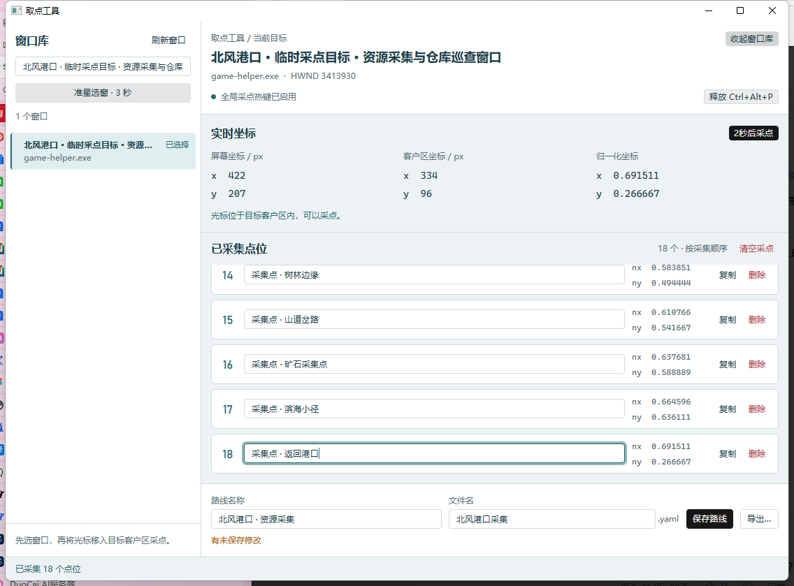

# 取点工具界面重设计

Rust + GPUI Kit 0.9.0 原生取点工作台，使用 `start.bat --picker` 打开。视觉与路线管理器共享浅色青灰主题；设计参考 `ui-ux-pro-max` 的桌面紧凑布局与操作反馈建议，以及 `frontend-design` 的内容与层级原则。

## 布局与视觉

默认客户区 1120×800，最小客户区 900×640；原生标题栏与边框另计。

- **窗口库**：左侧宽 280px，支持标题和进程名搜索、刷新及 3 秒准星选窗。每行显示窗口标题、进程名；当前目标有背景、边线和“已选择”文字。长标题省略，悬停及可访问名称保留全文。
- **当前目标**：右侧顶部显示目标标题、进程和辅助句柄信息，提供窗口库开关、热键状态与 `Ctrl+Alt+P` 开关。
- **实时坐标**：屏幕、客户区、归一化坐标各自成列；归一化值显示六位小数。未选择目标、光标位于客户区外、窗口失效或最小化时，显示原因并清除旧数值。
- **采集点位**：按真实采集顺序编号，名称直接编辑，右侧显示归一化坐标及复制、删除操作。点位列表独立滚动，追加后滚动到最新行，清空入口位于列表标题区。
- **固定保存栏**：路线名、文件名及 `.yaml` 后缀、保存状态、导出与保存按钮始终位于主区底部。操作结果固定显示于窗口底部；长消息省略时可悬停查看全文。

客户区宽度不足 1000px 时，窗口库默认收起；用户可以手动展开或收起，选择在本次会话保留。搜索和折叠只影响界面，不产生未保存状态。

| 用途 | 色值 |
|---|---|
| 工作台底色 | `#EDF2F4` |
| 工作面 | `#FFFFFF` |
| 主文字 | `#173F4A` |
| 主操作、选中和焦点 | `#236B73` |
| 未保存提示 | `#AA650E` |
| 错误和删除 | `#B43E4B` |

中文使用 Microsoft YaHei UI，坐标使用 Cascadia Mono，序号使用 Bahnschrift。正文 14px、辅助文字 12px、区域标题 16px。没有自动播放的装饰动画。

## 交互与数据保护

准星选窗延时 3 秒，延时采点为 2 秒，两种倒计时互斥，显示剩余秒数，并可通过按钮或窗口内 Escape 取消。热键启用后，取点窗口失焦也可采点。注册失败时显示原因，仍可使用延时采点。

清空、覆盖文件和未保存关闭使用同一种确认层。焦点默认进入安全选项，Tab / Shift+Tab 在确认按钮中循环，Escape 取消并恢复原焦点。确认期间禁用背景操作并丢弃采点事件；开始保存、刷新或关闭处理时取消倒计时。采样任务同时核对目标句柄、进程和交互版本，已取消或来自旧目标的后台结果不能追加点位。

已采集的点位属于当前目标，必须清空后才能更换目标。清空前提示点位数量；需要的内容应先保存。删除单个点位保持直接操作。

未保存关闭提供“保存并关闭 / 放弃并关闭 / 继续编辑”。只有路线文件和所需执行缓存均保存成功后才关闭。取消覆盖、取消导出、文件名错误、磁盘冲突或保存失败均保留窗口和内容。路线文件已写入但执行缓存失败时，保留最新磁盘快照和待保存状态，支持再次保存重试。

路线仍使用 `route/v1`。采点生成默认点击动作，位置存于 `operations[].pos`，不生成点位层 `pos`。保存使用既有原子写入、原文备份和磁盘快照检测；零点位路线继续遵循已有有效格式。没有修改配置格式、Win32 IPC 或 AHK 回放行为，也没有新增依赖。

## 实现与复验

[取点状态与操作](../crates/game-helper-desktop/src/picker.rs) 管理采样、热键、倒计时和保存；[界面渲染](../crates/game-helper-desktop/src/picker/view.rs) 负责各区域与确认层；[共享主题](../crates/game-helper-desktop/src/workspace_theme.rs) 定义配色和字体；[原生入口](../crates/game-helper-desktop/src/application.rs) 设置窗口标题与尺寸。`--probe` 保持独立主题。

输入实体在初始化或采点时创建，不在轮询渲染时重建。保留 `coordinates`、`picker-status`，并为窗口、字段、坐标分组和点位操作提供稳定可访问性 ID 及中文名称。实时坐标使用非实时播报的分组，重要操作结果单独作为状态反馈。

```powershell
scripts\cargo.cmd test --workspace --locked
scripts\cargo.cmd fmt --all -- --check
pwsh -NoProfile -File scripts\smoke-picker.ps1
pwsh -NoProfile -File scripts\smoke-picker-layout.ps1
# 验证统一启动入口优先使用的 Release 版本
pwsh -NoProfile -File scripts\smoke-picker.ps1 -Executable target\release\game-helper.exe
```

两个 UI 脚本分别创建唯一的 `.tools/picker-*` 隔离目录、关闭自动服务的配置和不会执行的 AHK 占位文件，使用脚本自身启动的原生 `--probe` 窗口作为目标，结束时清理自有进程。只在隔离目录写入测试路线，不请求回放。

## 本轮验收结果

本轮在 Windows、96 DPI（100%）下执行。Debug 运行完整交互验收，Release 运行布局与截图验收；所有 UI 数据和窗口均由隔离脚本创建。

| 检查 | 结果 |
|---|---|
| 工作区测试 | 65 passed、0 failed；另有 1 个 ignored 子进程入口，由父测试显式启动 |
| Debug / Release 构建 | 通过，统一启动入口优先使用的 Release 已更新 |
| Clippy / 格式 / diff 空白检查 | 通过；Clippy 仅报告已有模块的文档和风格警告 |
| 选窗、搜索与目标保留 | 通过，筛选列表不会清除已选目标 |
| 失焦全局采点与坐标精度 | 通过，默认点击动作坐标与客户区归一化值误差不超过 `0.000001` |
| 中文保存、缓存与剪贴板 | 通过，保留点名与路线名，不生成点位层 `pos` |
| 延时采点与准星取消 | 通过，按钮 / Escape 取消后等待超过原截止时间，不追加点位或更换目标 |
| 删除、清空和零点位路线 | 通过，取消清空保留内容，确认清空后可更换目标并保存零点位路线 |
| 确认层键盘与采点屏蔽 | 通过，默认焦点在取消，真实 Tab / Shift+Tab 在框内循环；确认期间全局采点不追加点位 |
| 目标失效 | 通过，失效原因可读取，不能采集失效窗口 |
| 覆盖与关闭保护 | 通过，取消 / Escape 保留文件，覆盖保留原文备份，错误文件名阻止保存关闭，纠正后完成保存与退出 |
| 默认 / 紧凑布局 | 通过，客户区 1120×800、900×640，以及 1000 / 999px 窗口库收起边界和手动开关 |
| 多点位滚动与固定保存栏 | 通过，默认采集 18 个中文点位，最小尺寸追加第 19 个后，最新点位、复制 / 删除和保存栏均在可视范围 |

Tab 使用取点窗口自己的确认层键盘上下文与动作处理，避免基础组件的默认导航进入背景输入框。忙碌操作结束时再次清空热键队列，倒计时保留到后台采样结果提交前，取消操作可使在途结果失效。

## 实际原生窗口截图

截图来自最终 Release 程序，展示路线只存在于内存；目标为临时 `--probe` 窗口。窗口库按演示目标筛选，截图不包含用户其他应用的窗口标题。



[最小客户区布局](assets/native-picker-compact.png) · [清空确认层](assets/native-picker-confirmation.png)

布局与交互依据 Windows 可访问性树、真实键盘事件和控件边界检查完成。当前模型的图片输入通道不支持读取图片，未进行截图逐像素目视验收。150% / 200% DPI、多显示器、系统 IME 组合输入与真实游戏回放仍需专项验收。
